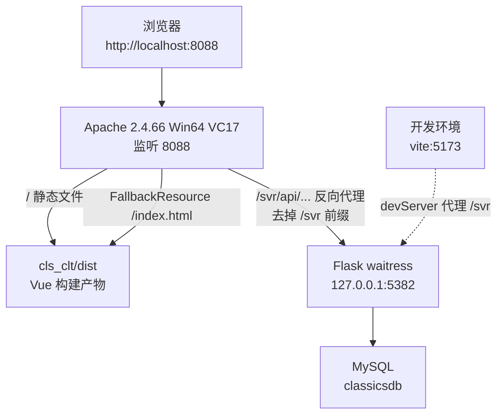

# 高级网页设计 · 古典文学网

Flask + Vue 3 前后端分离的古典文学作品展示网站。

开发环境 `http://localhost:5173`，生产环境 `http://localhost:8088`。

> 本文合并自 `README.md`、`部署说明.md`、`代码规范.md`、`版本说明_20261027.md`（2026-10-27）。

## 目录

1. [目录结构](#一目录结构)
2. [快速开始](#二快速开始)
3. [常用访问地址](#三常用访问地址)
4. [环境说明](#四环境说明)
5. [一键启停](#五一键启停)
6. [生产部署（Apache 8088）](#六生产部署apache-8088)
7. [代码规范](#七代码规范)
8. [接口文档位置](#八接口文档位置)
9. [排错清单](#九排错清单)
10. [版本与基线](#十版本与基线)
11. [与教材章节对应](#十一与教材章节对应)

---

## 一、目录结构

| 目录 | 说明 | 端口 |
|---|---|---|
| `cls_svr` | Flask 后端：REST 接口、JWT 鉴权、MySQL | **5382** |
| `cls_clt` | Vue 3 + TypeScript + Element Plus 前端 | **5173** |
| `redfilm_svr` | 「红影赏析」拓展任务后端（教材 2.6–8.6），库 `redfilmdbs` | **5383** |
| `redfilm_clt` | 「红影赏析」拓展任务前端 | **5175** |
| `images` | 共享图集库，各项目共用（详见 `images/README.md`） | — |
| `电影海报` | 红影赏析海报素材，按影片类型分 10 个子目录 | — |
| `正本_教材基线` | 教材第 5 章基线（JS 版，只读参考），内含 `启动正本.bat` | **5174 / 5000** |
| `Hi_view` | 教材 6.2.2 类视图（MethodView）示例 | 5497 |
| `Hi_upload` | 教材 8.2.1 / 8.2.2 文件上传与下载示例 | 5337 |
| `hi_flash` | 教材 7.2.1 / 7.2.2 中间件与消息闪现示例 | 5741 |
| `Hi_db` | 课程练习 | 5663 |
| `Hi_flask` | 课程练习 | 5216 |
| `Hi_Jinja2` | 课程练习 | 5814 |
| `Hi_vue` | 课程练习 | 5173 |
| `_archive` | 归档：`cls_svr_bak_20261021`、`poets_png_20261027` | — |

> `Hi_vue` 与 `cls_clt` 同为 5173，不要同时启动。
> `cls_svr / Hi_db / Hi_flask / Hi_Jinja2 / 正本_教材基线\cls_svr` 各自有独立 `.venv`。

## 二、快速开始

> **两条链路，别混用。**
> **开发** = Vite `5173`，热更新、改代码立即生效，后端用 `run.py`（Flask debug 自动重载）。
> **生产** = Apache `8088`，跑 `cls_clt/dist` 构建产物，后端用 `run_prod.py`（waitress）。
> 两者共用后端端口 `5382`，**同一时间只能跑一种**。切换直接用 `古典文学网.bat` 的菜单第 1 项（生产）或第 3 项（开发），脚本会先结束另一模式的后端。

> **顺序不能反：先起后端，再起前端。** 前端通过 Vite 代理把 `/svr` 转发到 5382，后端没起时页面会「骨架正常、数据全空」。

### 方式 A：双击脚本（推荐）

`古典文学网.bat` → 菜单 `3. 启动开发`。自动起 MySQL + 后端 + Vite，等 `5173` 真正就绪后才打开浏览器。

### 方式 B：手动开两个终端

#### 1. 启动后端（先）

```bat
cd /d D:\高级网页设计\cls_svr
.venv\Scripts\python.exe run.py
```

监听 `http://127.0.0.1:5382`，改 Python 代码自动重载。

#### 2. 启动前端（后）

```bat
cd /d D:\高级网页设计\cls_clt
npm run dev
```

浏览器访问 **http://localhost:5173**，改前端代码热更新。

## 三、常用访问地址

| 地址 | 说明 |
|---|---|
| http://localhost:5173/ | 首页 |
| http://localhost:5173/search/all | 搜索结果页（全部作品） |
| http://localhost:5173/clslist/4 | 文学列表（4 = 唐诗，换成其他 tid 即对应分类） |
| http://localhost:5173/cls/2/4 | 文学作品展示（作品编号 / 类型编号） |
| http://localhost:5173/register | 注册 |
| http://localhost:5173/login | 登录（演示账号 `xiaobai` / `123456`） |
| http://localhost:5173/out | 退出登录（清 Token 后回首页） |
| http://localhost:8088/ | 生产入口（Apache） |
| http://localhost:5174/ | 正本教材基线（需先跑 `启动正本.bat`） |

## 四、环境说明

- **Python 一律使用项目内 `.venv`**（3.14.7），不要用全局解释器
- **Node 22+**，前端依赖已安装，无需重复 `npm install`
- **MySQL 8.4**，库名 `classicsdb`，连接串见 `cls_svr/app/conf/dbconfig.py`
- **MySQL84 服务为手动启动**（StartType = Manual），开机不自启，用 `net start MySQL84` 或控制台菜单第 3 项
- 前端类型检查：`cd cls_clt && npm run type-check`

## 五、一键启停

双击 **`古典文学网.bat`**（会自动申请管理员权限）。菜单按「生产 / 开发 / 维护」分组：

| 分组 | 选项 | 功能 |
|---|---|---|
| 生产 8088 | 1 | 启动：MySQL 3306 + 后端 5382（`run_prod.py` waitress）+ Apache 8088 |
| 生产 8088 | 2 | 停止：Apache + 后端 + MySQL |
| 开发 5173 | 3 | 启动：MySQL 3306 + 后端 5382（`run.py` 自动重载）+ Vite 5173 |
| 开发 5173 | 4 | 停止：后端 + Vite + MySQL |
| 维护 | 5 | 仅启动 MySQL |
| 维护 | 6 | 仅重启 Apache |
| 维护 | 7 | 查看运行状态（四端口 + 5382 占用 PID + 双服务 + 接口自检） |
| 维护 | 8 | 启用 mod_wsgi（一次性部署，联网下载 VS 生成工具约 3 GB） |
| — | 0 | 退出 |

启动生产或开发时，脚本会先结束占用 `5382` 的旧后端，所以两种模式可以直接切换，不需要手动停。
开发模式启动后会等到 `5173` 真正监听才打开浏览器，Vite 冷启动慢也不会开出空白页。

> 该脚本为 GBK 编码，用记事本或 VS Code（选 GBK）编辑，改成 UTF-8 会导致中文行乱码报错。

## 六、生产部署（Apache 8088）

前后端已部署到本机 Apache，`http://localhost:8088` 就是生产入口。

### 6.1 现场架构



开发环境 `vite:5173` 的 devServer 代理 `/svr` 到 `5382`，与线上行为一致。线上不用 vite，直接用 Apache 跑 `dist`，前端代码未做改动。

### 6.2 已完成的工作

| 步骤 | 内容 | 位置 / 命令 |
|---|---|---|
| 1 | 下载 Apache 2.4.66 Win64 **VS17** 版（教材写 2.4.59，官方已下架，用同系列最新） | `D:\System\Apache24` |
| 2 | 改 `httpd.conf`：`ServerRoot` / `DocumentRoot` 路径、`Listen 8088`、`ServerName localhost:8088` | `D:\System\Apache24\conf\httpd.conf`（原文件备份 `.bak-20261022`） |
| 3 | 装载 `mod_proxy` / `mod_proxy_http`，`/svr/api` 反代到 Flask `/api` | 同上，文件末尾「古典文学网 部署配置」段 |
| 4 | 前端打包 | `cd cls_clt && npm run build` |
| 5 | 后端生产启动器 | `cls_svr/run_prod.py`（waitress，8 线程） |
| 6 | WSGI 入口（备用 / 教材 mod_wsgi 路线） | `cls_svr/wsgi.py` |

### 6.3 httpd.conf 关键配置

```apache
DocumentRoot "D:/高级网页设计/cls_clt/dist"
<Directory "D:/高级网页设计/cls_clt/dist">
    FallbackResource /index.html
</Directory>

ProxyRequests Off
ProxyPreserveHost On
ProxyPass        "/svr/api" "http://127.0.0.1:5382/api"
ProxyPassReverse "/svr/api" "http://127.0.0.1:5382/api"
```

`FallbackResource` 负责 vue-router history 模式的子路由兜底。

### 6.4 服务管理

服务已装好，启动类型「自动」，开机自启。以**管理员**身份打开命令提示符：

```bat
cd /d D:\System\Apache24\bin

httpd.exe -k start   -n "apache2.4"
httpd.exe -k stop    -n "apache2.4"
httpd.exe -k restart -n "apache2.4"
```

- `-k install` / `-k uninstall` 只在首次安装或彻底卸载时用，日常不要重复执行
- 前台跑过 `httpd.exe`（未装服务、或忘了走服务启动）时，用 `httpd.exe -k shutdown` 结束；`-k stop -n "apache2.4"` 只管服务方式启动的进程
- 报 `could not bind to address [::]:8088` 说明端口被占，通常是之前前台跑过 `httpd.exe`。`tasklist | findstr httpd` 找到 PID 后 `taskkill /PID <pid> /F`，再启动服务
- 装成服务后不需要再单独启动 Apache，控制台脚本会自动识别

### 6.5 改动后要做什么

| 改动 | 处理 |
|---|---|
| 前端 | `cd cls_clt && npm run build`，`8088` 读的是 `dist`，不重新打包仍是旧页面 |
| 后端 | 重启 `run_prod.py` 进程；若已切 mod_wsgi，则重启 Apache |
| `httpd.conf` | `httpd.exe -k restart -n "apache2.4"` |

### 6.6 mod_wsgi 路线（教材 9.3.2 / 9.3.3）

mod_wsgi 在 Windows 上没有预编译轮子（PyPI 只发布 `mod_wsgi-6.1.1.tar.gz`），必须现场用 MSVC 编译。缺「Microsoft C++ 生成工具」时报：

```
ERROR: Failed to build 'mod_wsgi' when getting requirements to build wheel
```

一键脚本为控制台菜单第 6 项，按顺序完成：

1. 检查并安装 VS 生成工具（`winget install Microsoft.VisualStudio.2022.BuildTools`，约 3 GB）
2. `set MOD_WSGI_APACHE_ROOTDIR=D:\System\Apache24` + `pip install mod_wsgi`
3. 调用 `switch_to_mod_wsgi.py`：备份 httpd.conf → 注释 ProxyPass 段 → 追加 `WSGIScriptAlias` 与 `/svr` 重写规则 → `httpd -t` 语法检查
4. `httpd.exe -k restart -n "apache2.4"`

手动排查：

```bat
set MOD_WSGI_APACHE_ROOTDIR=D:\System\Apache24
D:\高级网页设计\cls_svr\.venv\Scripts\pip.exe install mod_wsgi
D:\高级网页设计\cls_svr\.venv\Scripts\mod_wsgi-express.exe module-config
```

最后一条打印 3 行（LoadFile / LoadModule / WSGIPythonHome），复制进 `httpd.conf`。

WSGI 直连配置（替换掉 ProxyPass 段）：

```apache
WSGIScriptAlias /api "D:/高级网页设计/cls_svr/wsgi.py"
<Directory "D:/高级网页设计/cls_svr">
    <Files wsgi.py>
        Require all granted
    </Files>
</Directory>

LoadModule rewrite_module modules/mod_rewrite.so
RewriteEngine On
RewriteRule ^/svr(/.*)$ $1 [PT]
```

> Python 3.14 较新，mod_wsgi 若报版本不支持，改用 `pip install mod_wsgi==5.0.2`，或退回 3.12 的 `.venv`。
> 切过去之后 `run_prod.py`（waitress）可以不启动，两种跑法互斥。
> 回滚：`cls_svr\.venv\Scripts\python.exe cls_svr\deploy\switch_to_mod_wsgi.py --revert`

## 七、代码规范

新增文件一律按此执行；改动老文件时顺手对齐，不单独开重构任务。

### 7.1 文件头

每个源码文件（`.py` / `.ts` / `.vue`）开头必须有一段说明块，写清四件事：

```python
# ============================================================================
# <文件职责，一句话>
# ----------------------------------------------------------------------------
# 作用：<它解决什么问题，谁调用它>
# 用法：<入口命令或调用示例>
# 依赖：<数据库表 / 外部文件 / 环境变量>
# 约定：<不写会踩坑的注意事项>
# ============================================================================
```

前端用同一版式的 `//` 注释，`.vue` 写在 `<script setup>` 第一行。

### 7.2 函数与方法

统一使用 docstring，中文描述，含参数、返回值、异常：

```python
def load_poems(data_dir: Path) -> tuple[list[dict[str, str]], list[str]]:
    """读取并校验全部诗词 JSON。

    Args:
        data_dir: JSON 所在目录，缺文件时跳过而不是报错。

    Returns:
        (诗词列表, 错误信息列表)。错误列表非空时调用方应终止导入。

    Raises:
        FileNotFoundError: 目录不存在时抛出（这是配置错误，不该静默）。
    """
```

一句话能说清的小函数也至少保留一行摘要；纯工具函数可省 Args。

### 7.3 类型

- Python：函数签名全部标注类型；`Optional` 用 `X | None`（3.10+ 写法）
- TS：不允许隐式 `any`；对外函数写返回类型，事件回调参数写事件类型（如 `WheelEvent`）

### 7.4 变量与结构

- 常量全大写下划线：`DATA_FILES`、`ZOOM_KEYS`
- 魔法数字必须命名：`const CARD_SCALE = 0.83`，不写裸 `0.83`
- 配置与逻辑分离：路径、阈值、端口放 `conf/` 或文件顶部常量区

### 7.5 错误处理

- 边界处（读文件、连库、解析 JSON）必须处理并给出**中文可读**的错误，不允许裸 `except: pass`
- 校验类脚本：收集全部错误后一次性报出，别发现一个就退出（`--dry-run` 的用法）
- 后端接口：统一返回 `{code, msg, data}`，异常交给 `create_app()` 里的全局兜底

### 7.6 接口注释

前端每个 axios 调用、后端每个路由上方都要写：

```
接口名 / 调用方式（前端 /svr/api/... → 后端 /api/...）/ 参数 / 返回结构
```

新增接口时同步更新三处：调用处注释、蓝图文件顶部清单、`run.py` 顶部总览。

### 7.7 前端注释

- 覆盖组件样式时，注释里写清**为什么**要 `:deep()` / 提权（例如被 Element Plus 默认样式盖掉）
- 尺寸换算要留推导：`420 × 0.6897 ≈ 290px`，方便后人改一个值就知道另一个怎么变

### 7.8 提交前自检

| 检查项 | 命令 / 做法 |
|---|---|
| Python 语法 | `python -m py_compile <file>` |
| 数据脚本 | `scripts/seed_poems.py --dry-run` |
| 前端类型 | `cd cls_clt && npm run type-check` |
| 接口连通 | 起服务后 `curl --noproxy '*' http://127.0.0.1:5382/api/...` |
| 临时文件 | 清掉 `_tmp_*`、`__pycache__`、截图草稿 |

### 7.9 命名

| 位置 | 规则 | 示例 |
|---|---|---|
| Python 函数 / 变量 | 小写下划线 | `load_poems`、`cover_map` |
| Python 类 | 大驼峰 | `PoemSchema` |
| TS 函数 / 变量 | 小驼峰 | `installZoomLock` |
| Vue 组件文件 | 大驼峰 | `HeaderComp.vue` |
| 数据库表 | 小写单数 | `poem`、`classictype` |

## 八、接口文档位置

- 全局接口总览：`cls_svr/run.py` 文件头
- 单个蓝图接口清单：`cls_svr/app/api/*_blueprint.py` 文件头
- 前端调用位置与注释：`cls_clt/README.md` 的「前端接口清单」

## 九、排错清单

| 现象 | 原因 | 处理 |
|---|---|---|
| 页面能开，但轮播 / 导航 / 推荐区全空 | 后端没起，`/svr` 代理返回 502 | 启动 `cls_svr` |
| 页面完全打不开 | 前端没起 | 启动 `cls_clt` |
| 控制台 `Network Error` | 后端进程退出 | 重启后端 |
| 书封显示为空白卡片 | 该作品在数据库里没有封面文件名 | 补图到 `images/books/<类型>/`，再把文件名写入 `classics.cover` |
| 接口 502 / 500 | 后端没起 | `curl --noproxy '*' http://127.0.0.1:5382/api/classics/get-classictypes` |
| 接口 404（JSON 提示「请求的接口不存在」） | 蓝图没注册 | 蓝图在 `create_app()` 统一注册，勿在 `run.py` 重复注册 |
| 图片 404 | `images/books/` 下没有该文件名，或 `config.py` 里 `IMAGE_CLS_PATH` 不对 | 核对文件名与路径 |
| 8088 打不开 | 端口未监听或服务未起 | `netstat -ano \| findstr :8088`；看 `D:\System\Apache24\logs\error.log` |
| 页面白屏 | 没重新 `npm run build`，或 `dist` 里没有 `index.html` | 重新打包 |
| 刷新子路由 404 | 少了 `FallbackResource /index.html` | 补进 `httpd.conf` 后重启 Apache |
| 启动报「拒绝访问」 | 没用管理员运行命令提示符 | 用管理员重开终端 |
| 服务启动报 `could not bind to address [::]:8088` | 8088 被前台 httpd 进程占用 | `taskkill /PID <pid> /F` 后重启服务 |

> 判断技巧：F12 控制台看到 `GET /svr/api/... 502 (Bad Gateway)`，就是后端没启动，不是前端代码问题。

## 十、版本与基线

目录用途：区分教材基线（正本）与本项目实现（副本）。

```
D:\高级网页设计\
├── cls_clt\              副本：当前项目前端（运行版，继续开发）
├── cls_svr\              副本：当前项目后端（运行版，继续开发）
└── 正本_教材基线\
    ├── cls_clt\          正本：教材第 5 章基线前端（JS 版，只读参考）
    └── cls_svr\          正本：教材第 5 章基线后端
```

### 10.1 正本（教材基线）

| 项 | 值 |
|---|---|
| 来源 | `D:\Downloads\QQ\cls_svr等2项文件\` |
| 规模 | 34 个文件，112 KB |
| 技术栈 | JavaScript、Vite 5、Vue 3.4、Element Plus 2.7、Pinia 2、vue-router 4 |
| 页面 / 接口 | 5 个页面 / 9 个接口 |
| 运行配置 | 端口 5000，图片路径 `D:/cls_image/` |
| 启动 | `正本_教材基线\启动正本.bat`（后端 5000，前端 5174） |
| 状态 | 依赖已装可运行，但定位为只读参考 |

### 10.2 正本运行环境（2026-10-27 实测）

| 项 | 状态 |
|---|---|
| 前端依赖 | 已装，`node_modules` 就绪（Vite 5.4.21，esbuild win32-x64） |
| 后端环境 | `正本_教材基线\cls_svr\.venv`（Python 3.14.7），18 个包：Flask 3.1.3、Flask-SQLAlchemy 3.1.1、Flask-JWT-Extended 4.7.4 等 |
| 图片目录 | `D:\cls_image\cls`（119 张）、`D:\cls_image\head`（21 张），由 `images\` 扁平复制而来 |
| 启动 | `正本_教材基线\启动正本.bat`：前端 5174，后端 5000 |
| 验证 | 前端 5174 返回 200；`/svr/api/classics/get-classictypes` 代理返回 200；`head/logo.png`、`cls/bzz.jpg` 均返回 200 |

端口分配：副本 5173（开发）/ 8088（Apache），正本 5174，两套可同时运行。
MySQL84 未启动时接口返回 `data: {}`，页面无数据，但服务本身正常。

### 10.3 副本（当前项目）

| 项 | 值 |
|---|---|
| 位置 | `cls_clt`、`cls_svr` |
| 规模 | 前端 55 个源文件，后端 20 个源文件 |
| 技术栈 | TypeScript、Vite 8、Vue 3.5、Element Plus 2.14、Pinia 4、vue-router 5 |
| 页面 / 接口 | 14 个页面 / 19 个接口 |
| 运行配置 | 端口 5382，图片路径 `D:/高级网页设计/images/` |
| 状态 | 可运行，`古典文学网.bat` 正常启动 |

### 10.4 注意事项

1. 正本与副本的图片路径、端口、依赖版本均不同，不能互相覆盖文件
2. 正本 `UsersSchema` 序列化了 `upwd` 字段，会把密码返回前端，属安全缺陷，不要回迁
3. 正本为 JS 写法，副本为 TS 写法，同名文件不可直接拷贝
4. 端口分配：副本 5173（开发）/ 8088（Apache），正本 5174，两套可同时运行
5. 完整逐文件差异见 `D:\ChatFiles\Workbuddy\workbuddytest\QQ包与当前项目差异_20261027.md`

## 十一、与教材章节对应

| 教材 | 本机做法 |
|---|---|
| 9.3.1 下载安装 Apache、改 SRVROOT 与 8088、装服务 | 已做，服务已安装并设为自动 |
| 9.3.2 装 VS 生成工具 + `pip install mod_wsgi` + `module-config` | 脚本已备（控制台菜单第 6 项），VS 生成工具未装 |
| 9.3.3 配置 httpd.conf 指向 Flask | 已用 ProxyPass 等价实现；`wsgi.py` 已备好，装完生成工具即可切换 |

## 变更记录

| 日期 | 内容 |
|---|---|
| 2026-10-27 | 控制台菜单重构成「生产 8088 / 开发 5173 / 维护」三组：新增开发链一键启动（`run.py` + `npm run dev`）；启动任一模式前自动结束占用 5382 的旧后端。README 第二、五节同步改写 |
| 2026-10-27 | 补录第十节 10.2「正本运行环境」（来源 `版本说明_20261027.md` 第 44–70 行），原 10.2 / 10.3 顺延为 10.3 / 10.4 |
| 2026-10-27 | 四份文档合并成本文件：`README.md` + `部署说明.md` + `代码规范.md` + `版本说明_20261027.md` |
| 2026-10-27 | 修正失效引用：`启动站点.bat` 已由 `古典文学网.bat` 替代；`原始版本_20261020` 目录已不存在，改为 `_archive` 归档 |
| 2026-10-27 | 补录未记录目录：`电影海报`、`_archive`、`正本_教材基线` 端口 |
